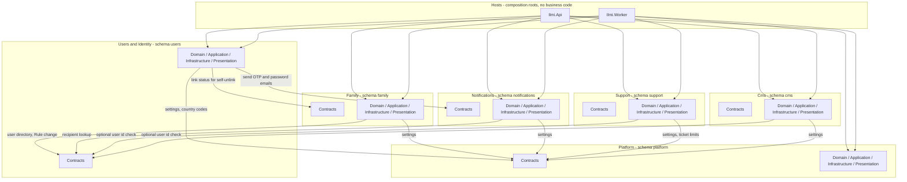

# ilmi backend architecture

Modular Monolith (style) with Clean Architecture inside each module (pattern), on ASP.NET Core / .NET 10. Six modules, two hosts, one SQL Server database with one schema per module.

## 1. Module architecture diagram

Solid arrows are allowed dependencies between modules and always point at another module's **Contracts** project. Nothing may reference another module's Domain, Application or Infrastructure.



`UsersIdentity.Application` and `Notifications.Application` reference each other's Contracts. That is allowed: Contracts reference nothing, so there is no project cycle.
Platform is the only module with no outgoing module dependency. Accessibility modes (frontend) and job executions (external database) are outside every module.

## 2. Module ownership

| Module | Schema | Owns | SRS |
|---|---|---|---|
| Users & Identity | `users` | **implemented on ASP.NET Core Identity**: `AspNetUsers` (main users table) with `external_users` / `internal_users`, Identity roles/claims/logins, Rules, special needs, user settings, OTP, sessions, Quick Login, login audit | UC002-UC008 |
| Family | `family` | family_links, Rule-transition triggers | UC013-UC017 |
| Notifications | `notifications` | in-app notifications, delivery outbox, push tokens | UC020, section 4 |
| Platform | `platform` | system_settings, country_calling_codes | configuration, GSR017 |
| Support | `support` | ticket types, tickets, attachments | UC019 |
| Cms | `cms` | local cache of the external CMS, onboarding completions | UC009-UC012, UC018 |

## 3. Layer dependency rules (enforced by the architecture tests)

```text
Presentation ──► Application ──► Domain ──► SharedKernel
Infrastructure ─► Application      Application ──► own Contracts
```

| Project | May reference |
|---|---|
| Contracts | nothing |
| Domain | SharedKernel |
| Application | own Domain, own Contracts, SharedKernel, other modules' **Contracts** |
| Infrastructure | own Application / Domain / Contracts, SharedKernel, other modules' Contracts |
| Presentation | own Application, own Contracts, SharedKernel, other modules' Contracts |
| Host (Api, Worker) | module Presentation/Application/Infrastructure; nothing references a Host |

## 4. Backend project and folder structure

```text
Ilmi.sln                                   36 projects
src/
  Host/        Ilmi.Api   Ilmi.Worker
  BuildingBlocks/  Ilmi.SharedKernel
  Modules/
    UsersIdentity/   Ilmi.Modules.UsersIdentity.{Contracts,Domain,Application,Infrastructure,Presentation}
                       Domain/Entities/{Users,Identity}      Application/{Commands,Queries}/{Users,Identity}
                       Infrastructure/Persistence/{Configurations/{Users,Identity},Interceptors,Migrations,Repositories}
                       Presentation/Controllers/{Users,Identity}
    Family/          Ilmi.Modules.Family.*
    Notifications/   Ilmi.Modules.Notifications.*
    Platform/        Ilmi.Modules.Platform.*
    Support/         Ilmi.Modules.Support.*
    Cms/             Ilmi.Modules.Cms.*
tests/
  Ilmi.ArchitectureTests   Ilmi.IntegrationTests
docs/
  architecture.md   database/database-design.md   database/erd.md   srs-open-questions.md
```

Each module project keeps the standard folders (`Domain/{Entities,ValueObjects,Enums,Events,Exceptions}`, `Application/{Commands,Queries,Abstractions,Dtos,EventHandlers}`,
`Infrastructure/{Persistence,ExternalServices}`, `Presentation/{Controllers,Requests,Responses}`). Empty folders carry a `.gitkeep`.

## 5. DbContext ownership

One DbContext per module, in its Infrastructure project, owning only that module's tables, with its migrations history table in the module's own schema. No cross-context navigation properties,
no DbContext injected across modules, no cross-schema foreign keys. Details: [database/database-design.md](database/database-design.md) section 7.
