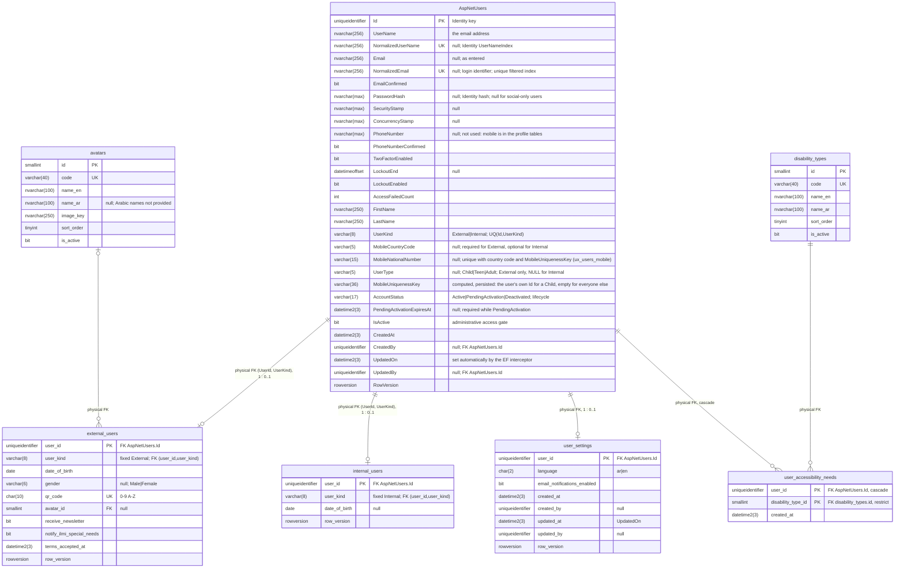
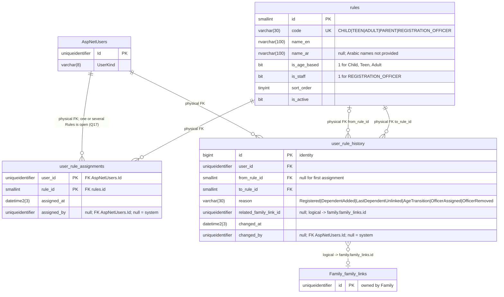
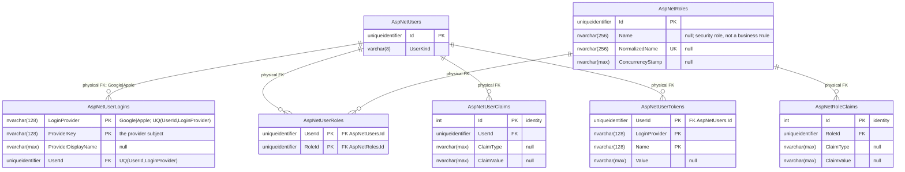
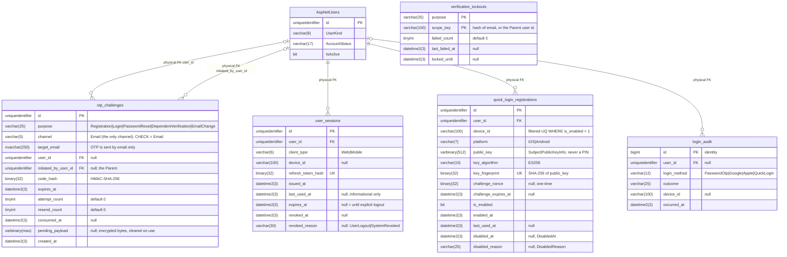
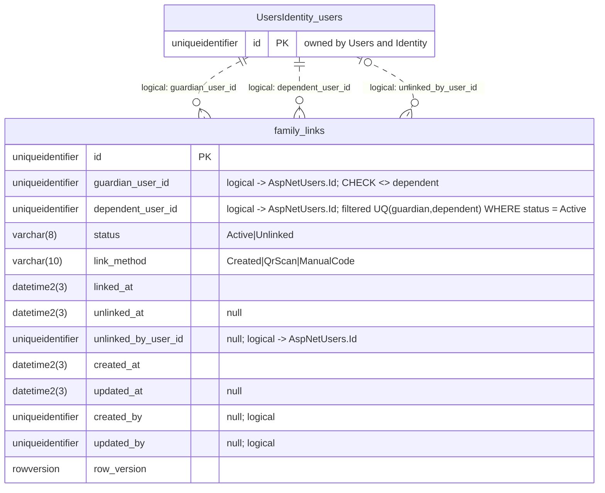
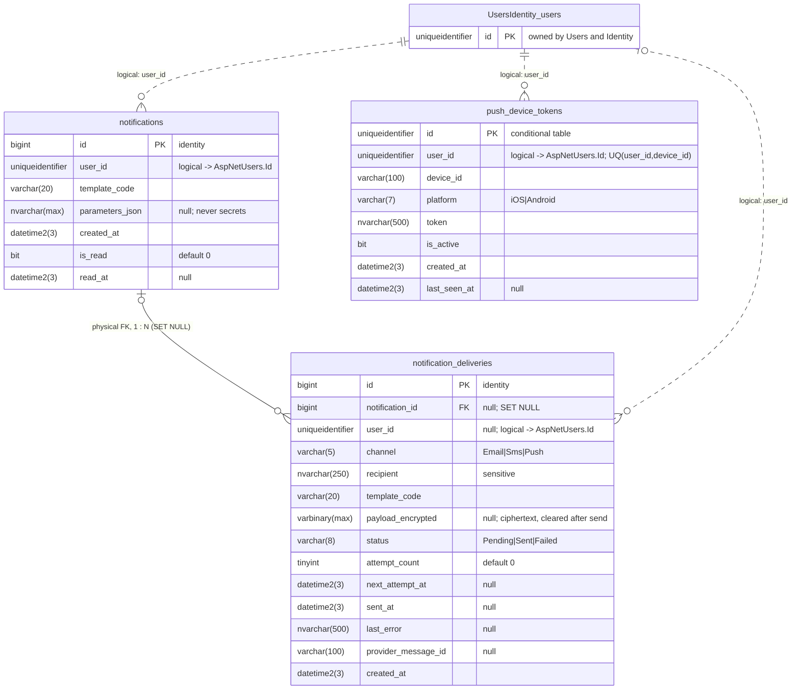
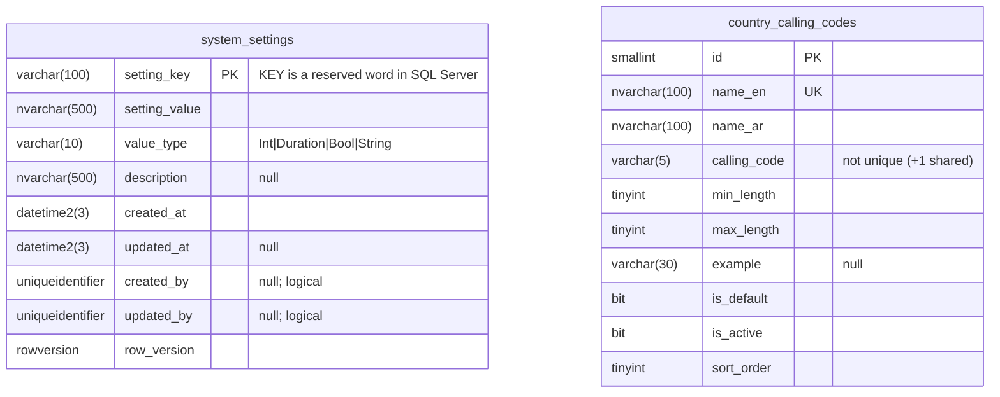
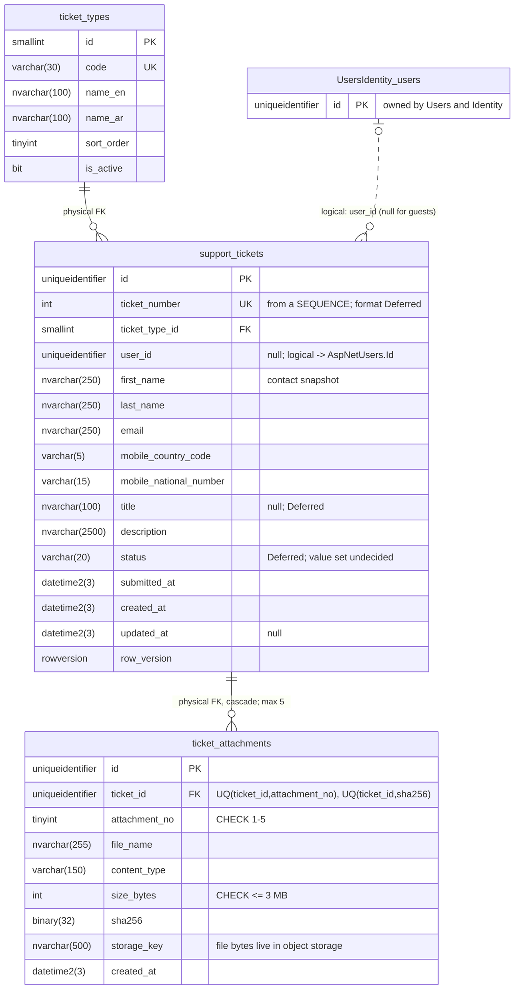
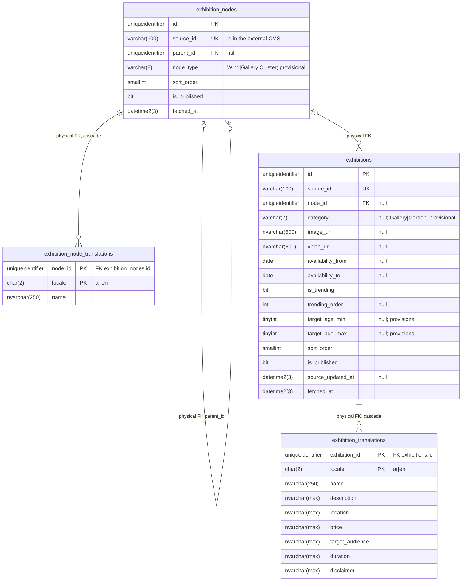
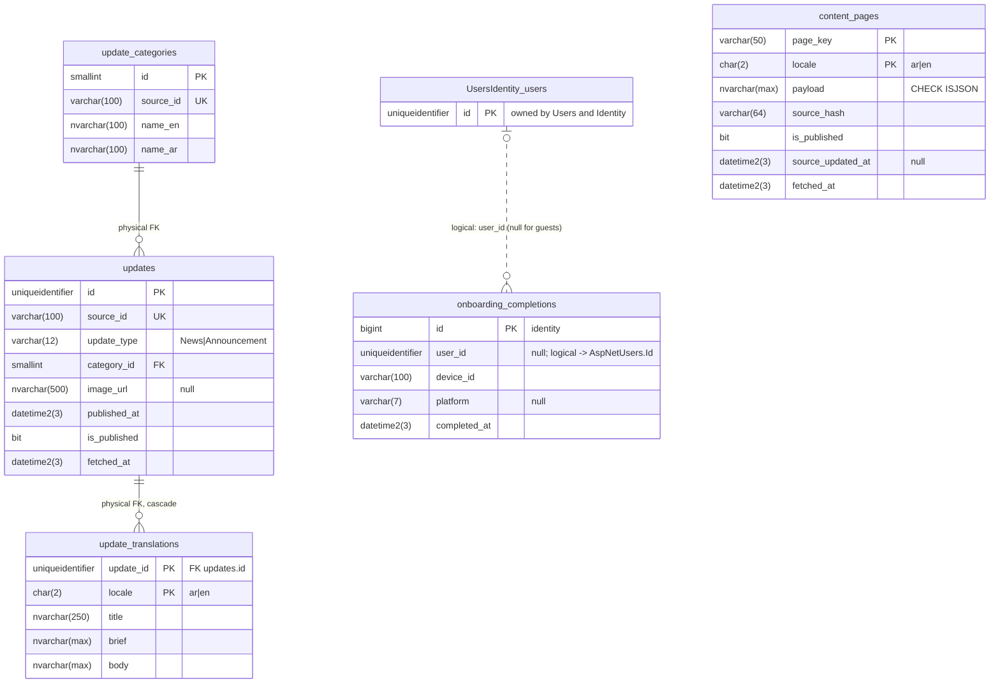

# ilmi database ERDs (one diagram per area)

Design only. Nothing here has been created in SQL Server. Target: one SQL Server database, one schema per module.

## How to read these diagrams

| Notation | Meaning |
|---|---|
| `PK` | Primary key |
| `FK` | Foreign key (a **physical** constraint in the database, same module only) |
| `UK` | Single-column unique constraint. Composite, filtered and CHECK constraints are written in the column comment and listed in [database-design.md](database-design.md) |
| comment `null` | Column is nullable. No comment on nullability means NOT NULL |
| comment `logical -> ...` | **Logical cross-module reference**: a plain column with no database foreign key. Existence is validated through the owning module's Contracts |
| **Solid line** | Physical foreign key between tables of the **same** module |
| **Dotted line** | Logical cross-module reference (no constraint). The other module's table is drawn as a stub named `<Module>_<table>` showing only its key |
| `\|\|--o{` etc. | Crow's foot cardinality: `\|\|` exactly one, `o\|` zero or one, `}o` zero or many, `}\|` one or many |

Types are SQL Server types (`uniqueidentifier`, `datetime2(3)` in UTC, `rowversion`). `+A` columns (the audit set) are written out only where
they matter: `created_at`, `updated_at`, `created_by`, `updated_by` on mutable business tables.

Diagram index: [1 Users core](#1-users--identity--accounts-and-profiles), [2 Rules](#2-users--identity--rules), [3 Authentication](#3-users--identity--authentication),
[4 Family](#4-family), [5 Notifications](#5-notifications), [6 Platform](#6-platform), [7 Support](#7-support), [8 CMS exhibitions](#8-cms--exhibitions), [9 CMS pages, updates, onboarding](#9-cms--pages-updates-onboarding).

---

## 1. Users & Identity: accounts and profiles

Schema `users`. **`AspNetUsers` is ASP.NET Core Identity's users table and the main users table**: email, password hash, lockout, security stamp
and phone fields come from Identity; the module adds the shared account fields. Person data lives in two profile tables, each with a foreign key
to `AspNetUsers`: `external_users` (visitors, parents, teens, children) and `internal_users` (staff). Email is the login identifier and stays on `AspNetUsers`.
**The mobile number and `UserType` are on `AspNetUsers` too**, so that ONE unique index can keep mobile numbers unique across Internal and External users
(Children excepted). In code, the Identity user lives in Infrastructure and the Domain `User` is a plain class; both map the same `AspNetUsers` row.
Identity tables keep Identity's standard names and columns; the module's own tables use snake_case.

---

## 2. Users & Identity: Rules

`UserType` (age) and `Rule` (business category) are separate. A Parent keeps `UserType = Adult`. `user_rule_assignments` holds the Rules **currently** assigned (PK (user_id, rule_id): the same Rule cannot be assigned twice; no unique constraint on user_id because one-or-several is an open decision);
`user_rule_history` is the append-only record of every change. Rules are **not** Identity roles: Identity roles (`AspNetRoles`) are security roles and are separate.

---

## 3. Users & Identity: ASP.NET Core Identity tables and authentication

Identity's standard tables: roles, claims, **external logins (Google and Apple, `AspNetUserLogins`)** and tokens. They are created by the Identity model and stay
empty or unused until needed (no roles are defined by the requirements). **Social-only users have a null `PasswordHash`.** Password, lockout (`LockoutEnd`, `AccessFailedCount`)
and external logins are handled by Identity; the module adds email OTP, sessions, Quick Login and the login audit.

`verification_lockouts` has no foreign key on purpose: its key is a hash of an email address (registration, when no user exists yet) or a Parent's user id.

---

## 4. Family

Schema `family`. Both user columns are **logical** references to `AspNetUsers.Id`.

No maximum number of guardians or dependents: there is no counter or cap anywhere.

---

## 5. Notifications

Schema `notifications`. **One notification has many deliveries (1:N).** A delivery may have no notification (OTP and password emails).

---

## 6. Platform

Schema `platform`. Two independent reference tables with no relationships. Accessibility modes (frontend only) and `job_executions` (external job database) are intentionally absent.

---

## 7. Support

Schema `support`. Details marked **Deferred** (ticket numbering format, statuses, title, guest data retention; Q15) are not decided here.

---

## 8. CMS: exhibitions

Schema `cms`. Local cache (read model) of the external CMS. Hierarchy and categories are **provisional** (Open): the requirements do not define them clearly.

---

## 9. CMS: pages, updates, onboarding

`onboarding_completions` is application data (UC012 BR03), not part of the cache.

